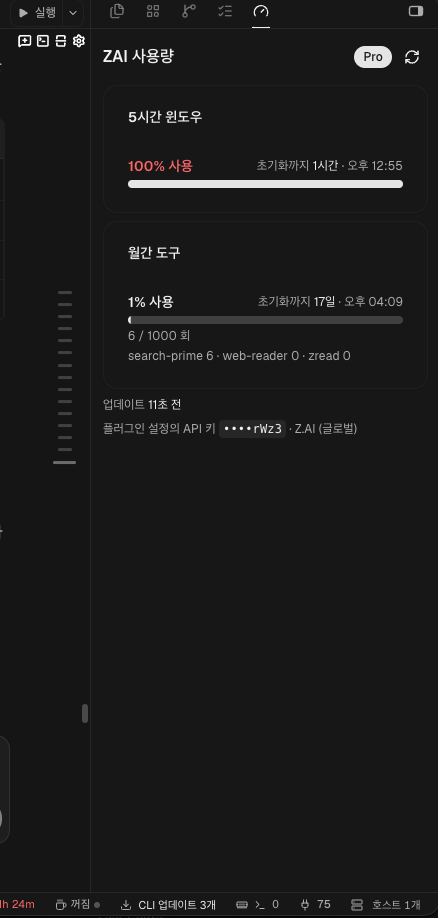
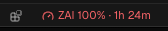

# ZAI Usage

GLM Coding Plan usage in Orca: a right-sidebar panel (`src/panel.tsx`) and a status bar item, each
showing how much of every quota window is used and how long until it resets. The numbers come from
Z.AI's quota endpoint (`GET /api/monitor/usage/quota/limit`), read by the plugin's own worker
(`src/worker.ts`), because a panel cannot reach the network. The worker reads again on an interval
and the moment a window resets, with one request in flight at a time; the panel asks it with
`plugin.request` and hears every refresh through `orca.panels.post`, both typed by
`src/protocol.ts`. `src/zai.ts` calls the endpoint and reads its answer, and `src/messages.ts` is
what the panel says: English, or Korean in a Korean Orca. Orca transpiles every file when it loads,
so there is no build step: save, and the panel or the worker reloads.

## What it looks like

<p align="center">
  
</p>

<p align="center">
  
</p>

The panel asks for an API key until it has one, then draws one card per quota window. The status
bar item names the window that runs out first and how long until it resets; here the five-hour
window is spent, so it is red. English and Korean follow Orca's UI language.

## Set up

1. Load the plugin (see [Develop](#develop)). Orca first shows the access it asks for: to run its
   own code, and to keep its settings and an encrypted secret.
2. Open the **ZAI Usage** panel in the right sidebar and paste the API key of your GLM Coding Plan.
   It is saved in the plugin's encrypted secrets.
3. Pick the region: Z.AI (Global) or BigModel (China).

On a device without an OS key store, where Orca cannot encrypt a secret, give the key another way:
the plugin's **API key (fallback)** setting in Orca Settings, which is saved as plain text, or
`ZAI_API_KEY` in the environment Orca starts with.

## What it shows

- One card per quota window Z.AI reports: the five-hour token window, the weekly one when the plan
  has it, and the monthly tool calls with their per-tool counts. Each card has the share used, what
  was used of what, and when it resets: a countdown Orca keeps current, beside the exact local time.
- A status bar item with the share used in the window that runs out first and how long until it
  resets, such as `ZAI 47% · 2h 13m`. Hovering shows every window, and the panel's refresh button
  reads again at once. Its colour warns at 70% used and turns red at 90%.
- When a read fails, the last good numbers stay on screen with the reason, and the status bar keeps
  them in a warning colour.

Z.AI names no reset time for some windows, and now and then one that cannot be right for the window
it belongs to (a five-hour window "resetting" in ten hours). Such a time is left out rather than
counted down to.

## Develop

```sh
orca plugin validate .
orca plugin test .                # src/*.test.ts(x): the endpoint's answer, the worker and the panel
orca plugin check .               # renders the panel in each state src/panel.check.ts names
orca plugin dev watch . --check   # loads it into Orca and reloads on save; Ctrl-C unloads it
```

`npx -p typescript tsc -p .` type-checks against the typings `orca plugin types .` writes to
`.orca/types/`.

These need the Orca desktop app: a headless Orca server has no plugin service, and answers "Plugin
service is not available on this runtime". With the folder loaded, `orca plugin shot
local.zai-usage --status-bar` saves a PNG of the status bar item, and `orca plugin dev request .
usage.refresh` calls the worker as the panel does.

Orca names the publisher after where the plugin is installed from: the GitHub or GitLab owner of
its repository, or `local` for a folder. See
https://github.com/stablyai/orca/blob/main/docs/reference/plugin-authoring.md.

## License

MIT. See [LICENSE](LICENSE).
